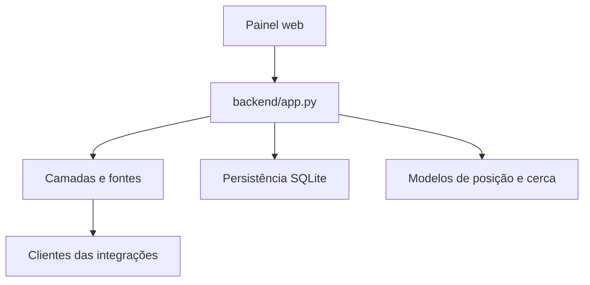

# Arquitetura do Sentinel Atlas

O backend FastAPI publica endpoints para a interface, consulta integrações e armazena registros locais. O [catálogo de fontes](../DATA_SOURCES.md) ajuda a interpretar a origem dos objetos no painel.

| Componente | Função |
| --- | --- |
| [backend/app.py](../backend/app.py) | Recebe as entradas HTTP, importa modelos de domínio e compõe as respostas por recurso. |
| [backend/geo_layers.py](../backend/geo_layers.py) | Resolve camadas e transforma respostas em estruturas geográficas consumidas pelo painel. |
| [backend/source_clients.py](../backend/source_clients.py) | Encapsula clientes e chamadas às fontes de dados. |
| [backend/storage.py](../backend/storage.py) | Persiste cercas, posições e sessões do navegador. Contém a configuração de retenção de posições. |
| [backend/routing.py](../backend/routing.py) | Implementa o componente de roteamento. |
| [backend/ai.py](../backend/ai.py) | Reúne a análise de situação e a consulta do copiloto. |

A origem de posição pode variar por integração. Ao alterar a camada de consulta, preserve os campos de origem, timestamp e estado usados para interpretar os dados. Ao mudar a persistência, reveja os testes de retenção, sessões e recuperação indicados no [guia de validação](GUIA_DE_VALIDACAO.md).
